# Approval workflow: side panel and padded dialog

Open the catalog's Overlays page, or `/?example=approval-workflow`, and choose **Create new approval**.

The example defaults to a right-hand `SidePanel size="workflow"`, with a **Workflow layout** selector to compare it with the large padded `Dialog size="workflow"`. Both use the existing accessible overlay, preserve a scrollable body and visible padded footer, trap focus, support Escape and return focus to the opener. The catalog retains the same saved draft when switching layouts after closing. Default dialogs, full-screen dialogs and default side panels retain their existing dimensions.

The workflow side panel is up to 640 pixels wide, fills the available width on smaller screens and slides in from the right. Header, content and footer use the standard panel padding (20 pixels at comfortable density, 16 at compact density); buttons keep their natural widths. Motion honors the reduced-motion preference. The large dialog provides a contrasting framed layout with a backdrop, a maximum width of 1,440 pixels and 24-pixel viewport gutters (12 on narrow screens).

`WorkflowProgress` now responds to its own available width rather than the viewport. At 600 pixels or less it shows the numbered/checkmarked steps with the active step name underneath. This avoids squeezing five labels into a side panel on a wide monitor. App-owned eligibility and completion rules are unchanged.

The catalog example demonstrates the requested order:

1. **Start approval** — name the approval and choose or create one customer. Save and continue requires both fields and creates a resumable example draft.
2. **Connect designs** — optionally add multiple Cabinitron designs, upload other design documents, or use both. Going back retains the selections and uploaded-document names.
3. **Generate customer packages** — generate each connected design's package. Later steps remain unavailable until every required package is ready. If no Cabinitron designs are connected, skip this step in both directions and use the uploaded design PDF.
4. **Finalize approval request** — review the name, recipient, selected designs, packages and instructions. Saving makes the example ready to send and locks its earlier fields.
5. **Send to customer** — review the recipient and attachments, then confirm the simulated send.

Completed, eligible steps can be revisited from the progress control or Back. Unavailable later steps are visibly disabled and cannot be selected by keyboard or pointer. Closing after step one preserves the title, customer, selections, packages and current step; Resume restores them. Step changes focus the content heading. Creating a new example does not overwrite the existing resumable example until step one is completed.

This is a catalog prototype using synthetic records, browser-local draft storage and simulated package generation/delivery. Cabinitron must own authenticated server-side drafts, record creation, revision/package locking, immutable approval requests and email delivery in a separate application review after the catalog behavior is confirmed. No production data, PDFs or emails are created here. The example supports both native-design and uploaded-only paths; uploads retain names and metadata in the example, not document bytes.

## Captured interface

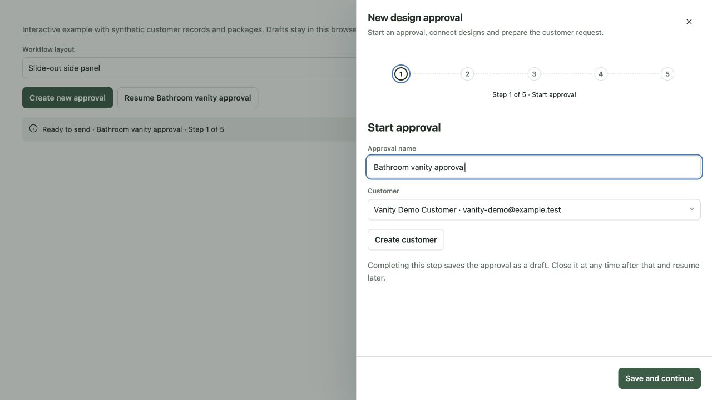
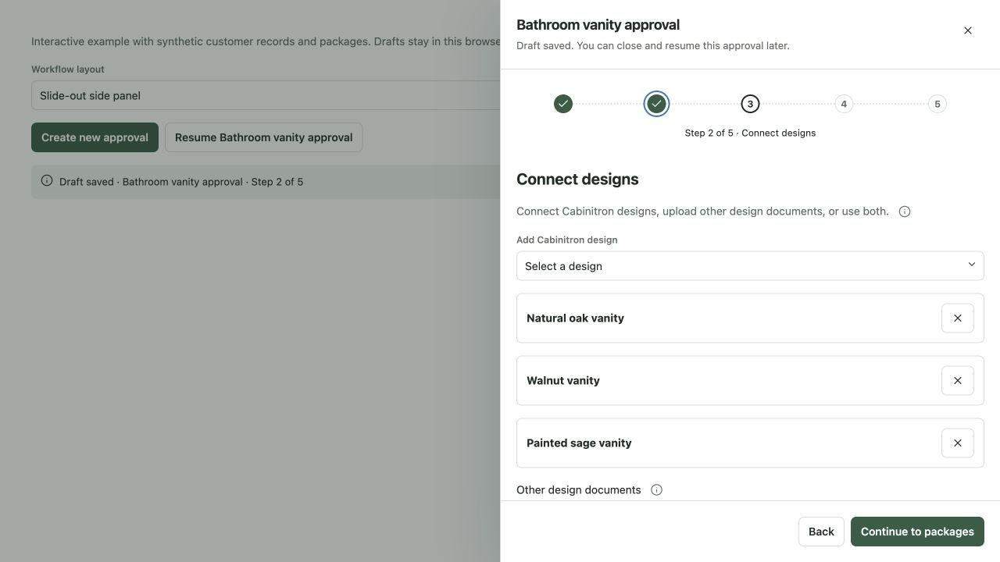
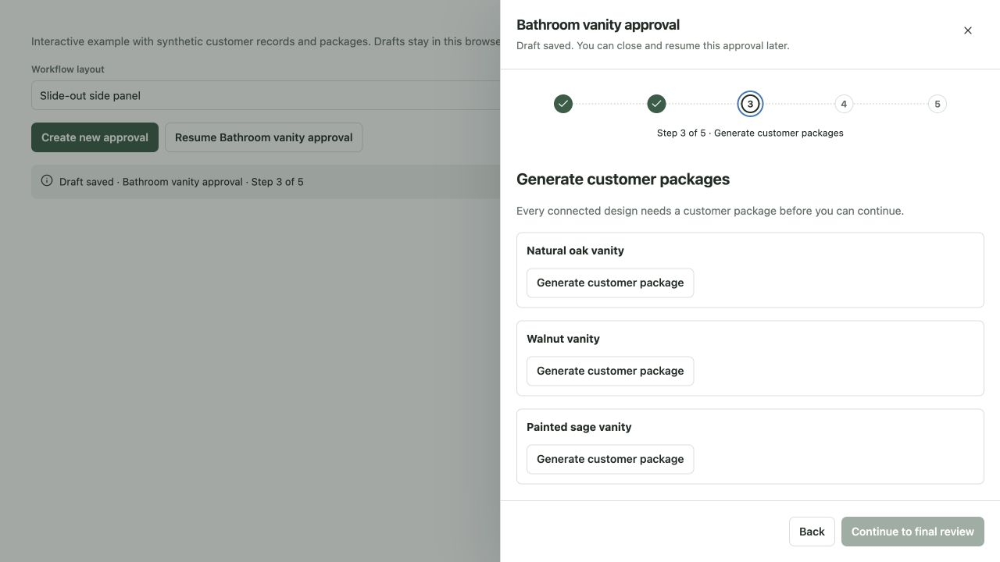
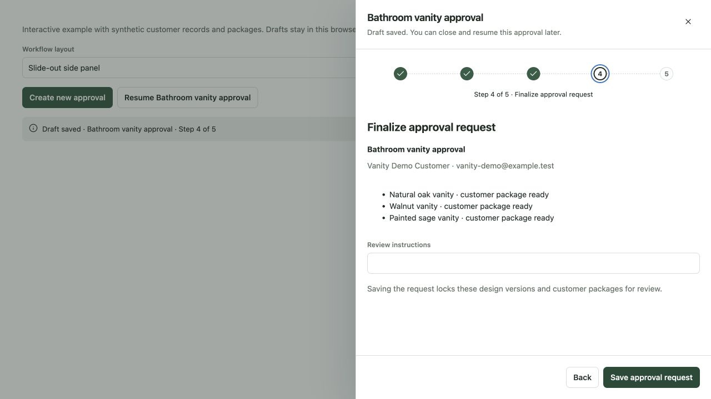
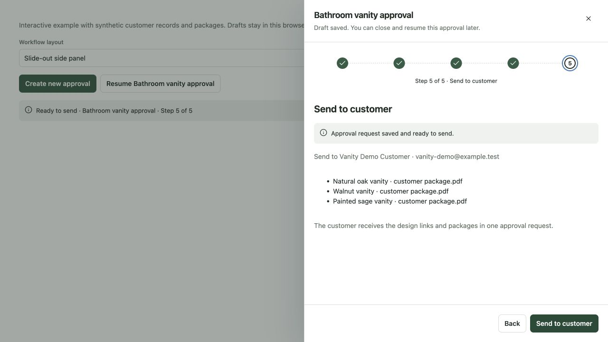
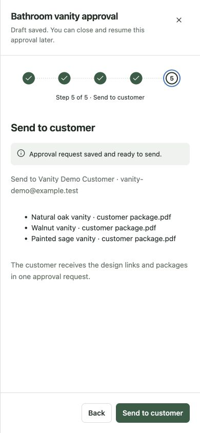
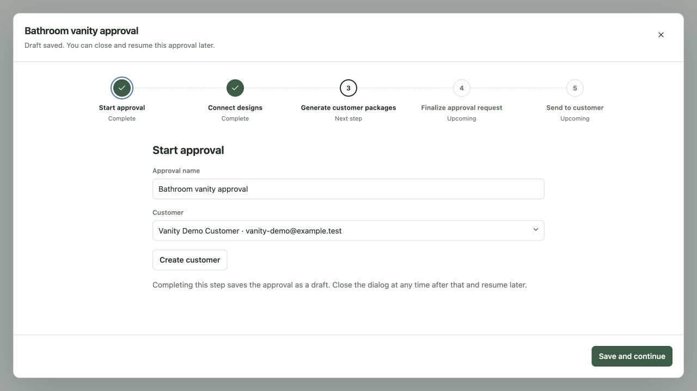

The following earlier captures document the previously reviewed full-screen composition and uploaded-only behavior:

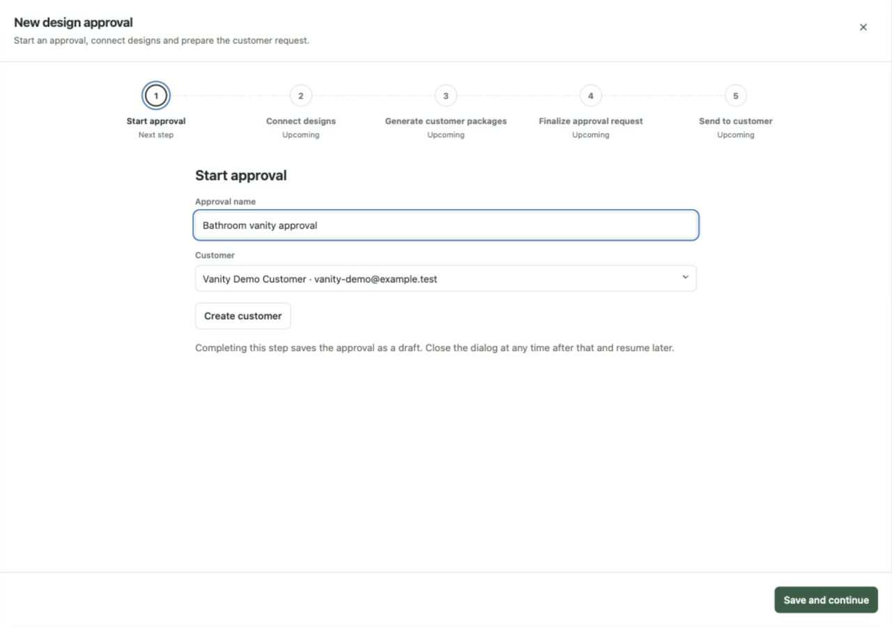
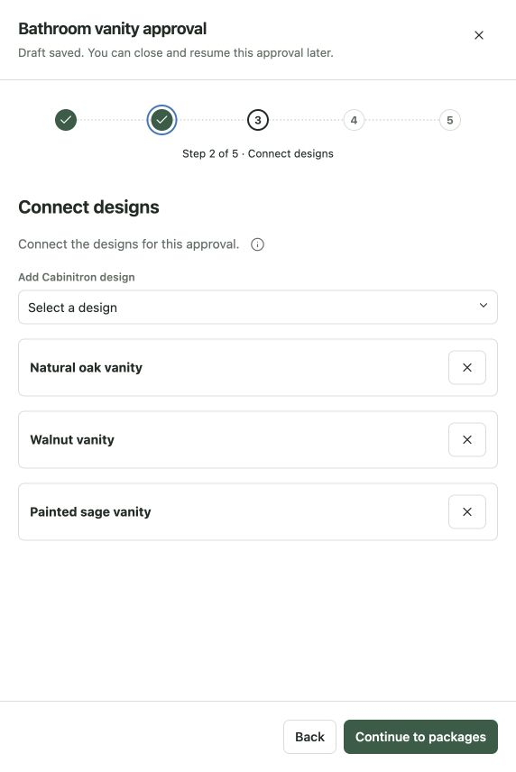
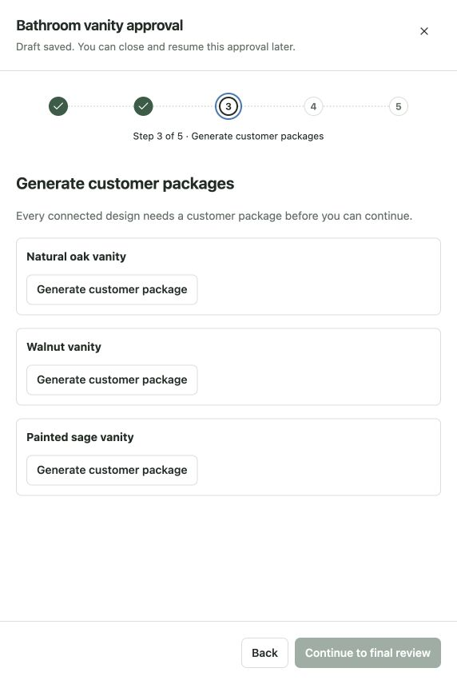
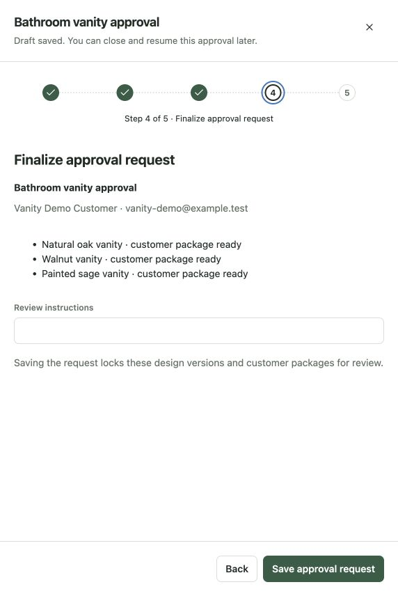
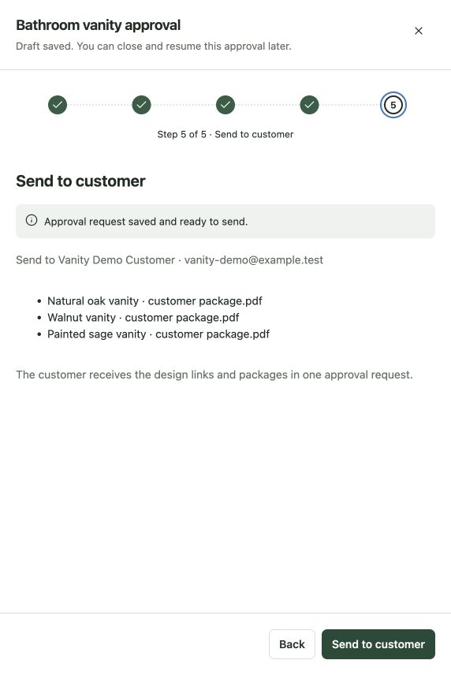
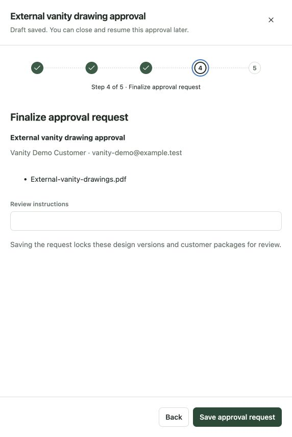
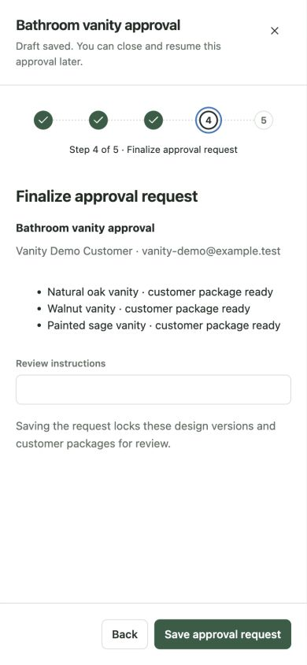

## Validation

Lint, type checking, library/catalog builds, package-content verification and all 143 component/catalog tests passed. Workflow tests cover required fields, draft resumption, backward navigation, package gating, explicit send confirmation, and retaining the same draft when comparing surfaces. Overlay focus/dismissal tests cover the workflow side panel and padded dialog alongside full-screen/default dialogs and default side panels.

Actual browser checks used synthetic data at 1280×720, 390×844 and 390×600. The desktop panel measured 640 pixels wide, its footer retained 20-pixel padding and neither desktop nor narrow layouts had horizontal overflow. At the shortest viewport, the content scrolled independently while footer actions stayed within the viewport. All five steps were inspected in the panel, including three connected designs, required package gating, final review and readiness to send. No email was sent. The earlier uploaded-only skip behavior remains covered by the catalog tests.

This side-panel/framed-dialog comparison is awaiting user confirmation before any new application adoption. The earlier full-screen workflow behavior was already confirmed; this revision changes the surface under review, not the business sequence.

## Follow-on exploration: estimates and invoices

Approval is the first workflow to complete. Estimate and invoice adoption follows it in separate application reviews. The reusable boundary is the task surface, persistent navigation/footer, eligible progress steps, draft resumption and local errors. Business meaning, validations and persistence stay with each app.

| Pattern | Approvals | Estimates — exploration | Invoices — exploration |
| --- | --- | --- | --- |
| Start | Name and customer; save resumable draft | Name and customer; save resumable draft | Customer and source estimate/order, or standalone invoice; save draft |
| Connect | Multiple saved designs | Designs, scope and optional alternatives | Approved source scope or standalone billable lines |
| Prepare | Required customer design packages | Customer packages, selling prices, choices, discounts and taxes | Amounts, taxes, due date and payment instructions |
| Finalize | Review then freeze design/package snapshots | Review then issue an immutable estimate revision | Review then issue an immutable invoice revision |
| Deliver | Explicit send to selected customer | Explicit send; customer options/approval remain a separate customer journey | Explicit send; payment and receipt remain separate customer actions |

The same progress component can present these flows with app-supplied labels and completion rules. Selecting a step is navigation, never proof that work is complete. Earlier editable steps retain their values. Invalidating an earlier requirement locks downstream steps again. Issued documents remain readable; changing their content uses the existing revision/correction rules rather than editing a frozen document in place. Closing after the initial save must preserve an authenticated server-side draft when adopted by Cabinitron; browser-local persistence in this catalog is only a demonstration.

Open questions for the later catalog passes: which existing estimate/order data can prefill invoices, which preparation steps apply to standalone documents, where an estimate's optional design packages belong, and how the send step presents a previously issued document. These are exploration notes, not approved application behavior.
