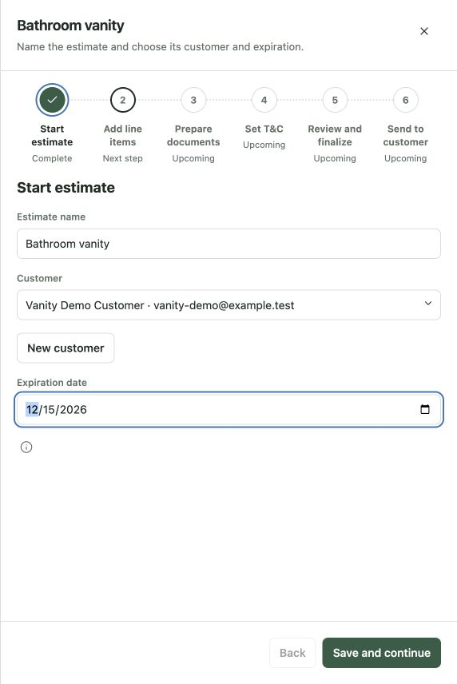
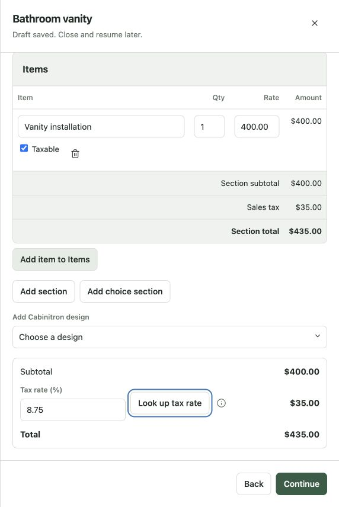
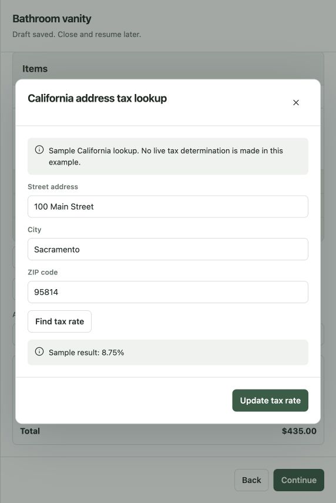
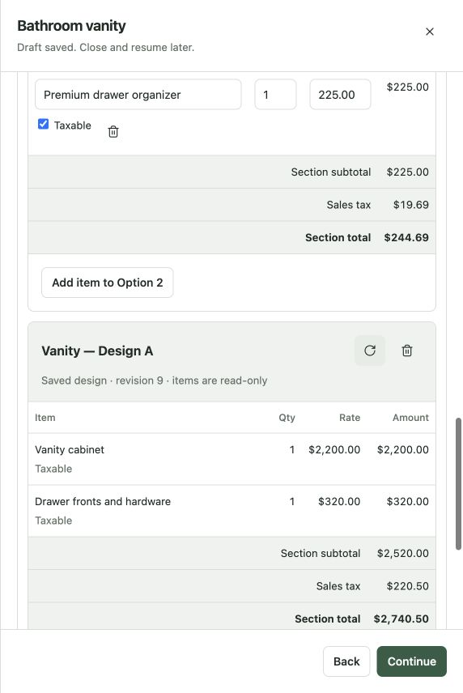
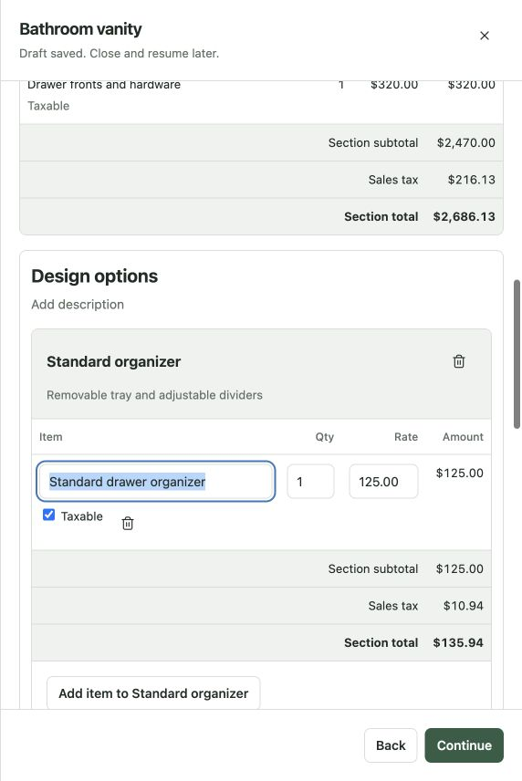
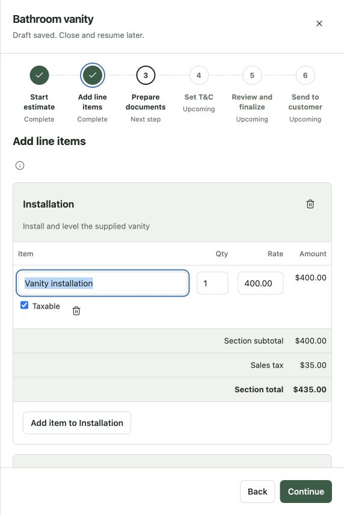
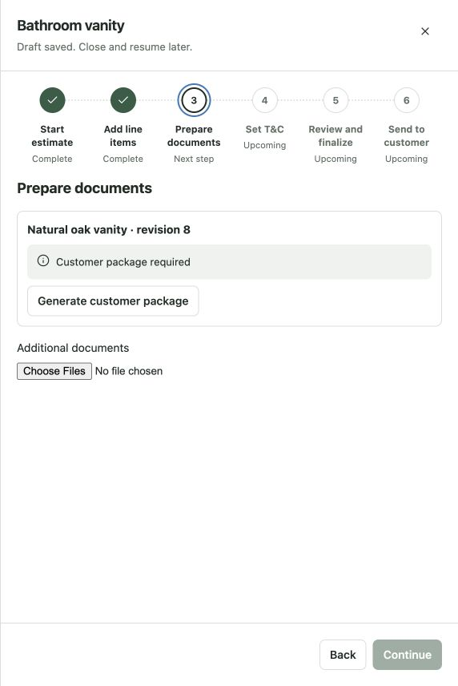
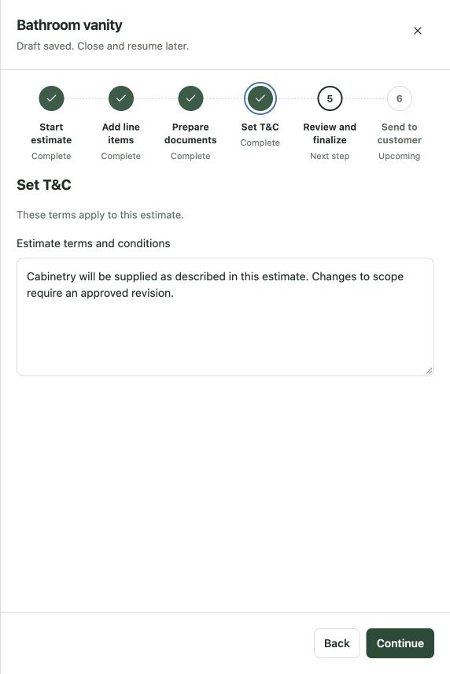
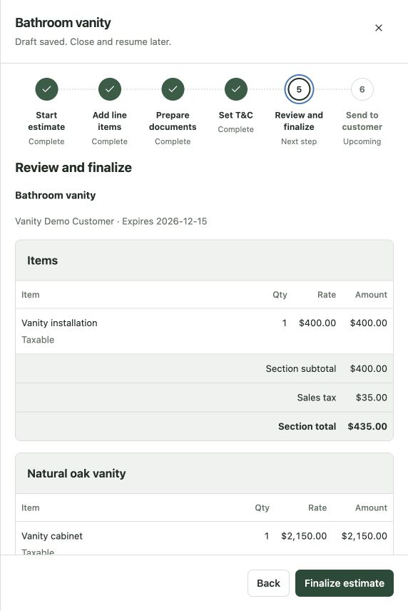

# Six-step estimate preparation

Open **Create estimates** in the catalog, or `/?example=estimate-workflow`, then **Create new estimate**. This is a working catalog composition using the existing workflow side panel, WorkflowProgress, DocumentSection, DocumentChoiceGroup, fields, buttons and dialogs. The shared DocumentSection adds compact header actions, optional inline title/description editing and footer actions. DocumentChoiceGroup also supports inline title/description editing. These remain presentation callbacks; no application data model changes are included.

1. **Start estimate** — enter the name, select/create a customer and choose an expiration date. Save and continue requires all three, and saves a resumable example draft. Closing and resuming restores edits and the current step.
2. **Add line items** — edit descriptions, quantities, USD unit rates and Taxable flags in customer-style tables. Add sections with titles, descriptions and separate subtotals. Regular sections and choice options are each one card: click their header title or description to edit in place. Enter or blur saves, Escape cancels without closing the workflow. There are no duplicate metadata fields above the cards. Remove stays in the header; Add item stays inside the card footer. Create a choice section first, then add saved design options or line-item alternatives directly inside it. A new choice is generically titled **Design options**, starts empty and makes no assumption about finishes, materials, dimensions or layout. Its title and description are editable. **Add design option** selects any saved sample design; **Add item option** creates an alternative containing an editable first row. Each choice needs at least two complete alternatives. Adding a design immediately supplies read-only rows and its subtotal. Update and remove icon controls sit alongside the design title in its shaded header. **Update to latest revision** explicitly refreshes the sample design and invalidates its old package.
3. **Prepare documents** — generate/rebuild a customer package for the exact revision of each linked design, including options. Continue remains unavailable until every linked design has a matching package. Additional PDF/PNG/JPEG files can be selected and removed. Native designs are optional.
4. **Set T&C** — edit the terms for this estimate, without changing a global template. Empty terms prevent continuation.
5. **Review and finalize** — review the same section tables, option groups, overall summary, customer, expiration, documents and terms. Finalization locks earlier fields. **Prepare a new revision** enables edits again without representing them as an in-place edit to an issued document.
6. **Send to customer** — a separate confirmation simulates delivery and marks the step complete. No email is sent.

The entire estimate summary is **Subtotal → tax rate and tax amount → Total**. Section subtotals remain in their own tables. Each row's tax is rounded to cents and tax-exempt rows are excluded. With unresolved customer choices, subtotal, tax and total each show the appropriate range across alternatives; shared work is included once. The customer-facing estimate's exact selected-price journey remains a separate pattern.

The tax lookup button sits beside the overall tax-rate field. It opens a California address dialog; finding a sample result does not change the estimate. **Update tax rate** explicitly applies the result and closes the dialog. Editing the lookup address invalidates the previously found result. This catalog returns a clearly identified synthetic rate, not a live tax determination.

## Persistence and application boundary

All customers, designs, prices and actions are synthetic. The browser stores only the example draft and uploaded filenames/types, not document bytes. Package generation, current-revision lookup and sending are simulated. Customer records created in this example exist only in the example. A new draft replaces the resumable example after its first save.

Cabinitron adoption must be a separate application review after behavior confirmation. It must own authenticated tenant-scoped drafts, actual editable estimate sections/descriptions, choice-first data entry, pricing calculations, latest-design refresh and read-only source rows, immutable package snapshots, external document bytes, per-estimate terms, live California lookup, finalization/revision rules and confirmed email delivery. None of those production mutations are performed here. Invoices remain outside this change.

## Evidence and validation

Lint, type checking, catalog/library builds, all 150 tests and package-content verification passed. Seven interaction tests cover initial requirements and resumption, direct item edits, taxable toggles and tax update semantics, the six-step finalization/send sequence, design refresh invalidating its package, choice-first manual entry with section totals, and adding arbitrary saved designs without prefilled finish alternatives, inline save/cancel behavior, and consolidated regular-section removal.

Browser inspection exercised the start, item editing, lookup, design refresh, package, terms and review steps. At the observed 572px viewport, page scroll width matched the viewport width. The browser check did not send email. Automated tests cover the simulated final-send completion. Numerical examples and imagery are demonstration data, not production pricing defaults.

