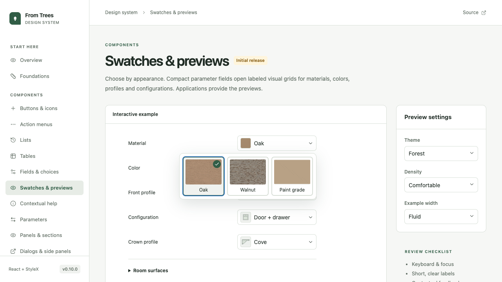
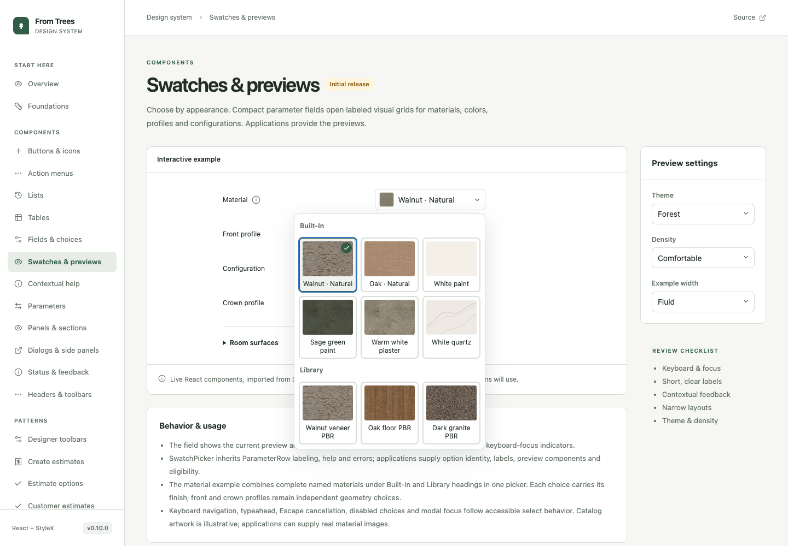
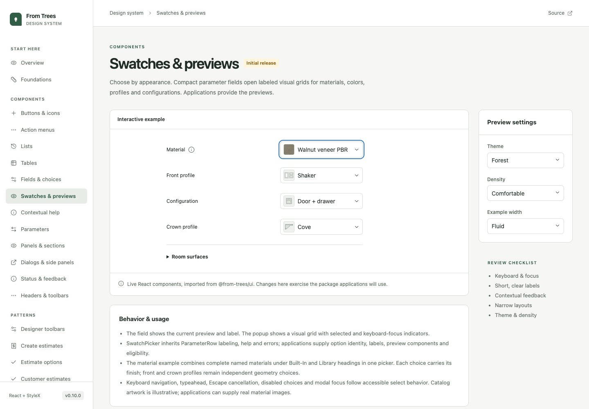
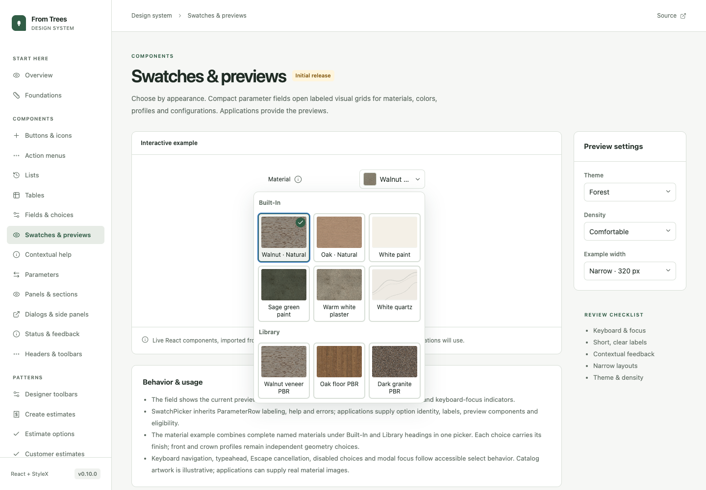

# Grouped swatch picker review

The Material example in **Swatches & previews** now uses one visual picker with **Built-In** and **Library** sections. Each entry is a complete named material, including paints such as Warm white plaster. The selected field retains its preview. There is no separate color or sheen control in this material example.

Applications provide names, images, group membership, eligibility, saved choices and persistence. These catalog examples are illustrative and do not access business libraries, change pricing or rewrite saved designs. Cabinitron adoption must follow explicit confirmation of this catalog behavior in a separate application change.

## Review

1. Open the Swatches & previews catalog page and then Material.
2. Select a Library entry. The field shows its image and complete name.
3. Reopen it and navigate with the keyboard across both groups. Escape cancels navigation; Enter selects. Typeahead works across the full option list.
4. Try Narrow · 320 px in Example width. The popup remains bounded, with readable labels and a visible selection.

## Captures

Captured from the actual local catalog with synthetic examples.

Before:

After:

Selected library material:

Narrow example:

