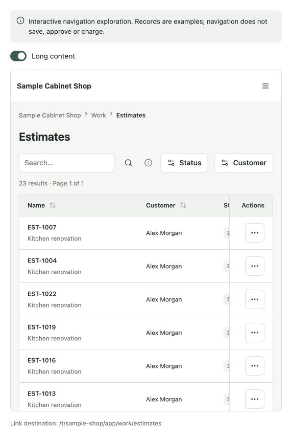
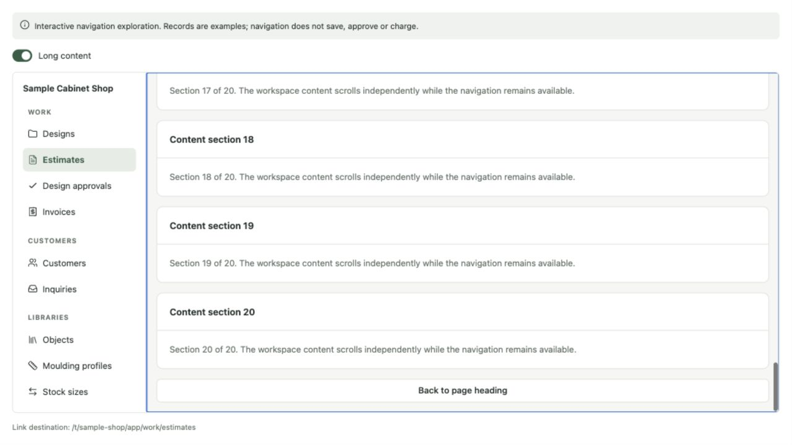
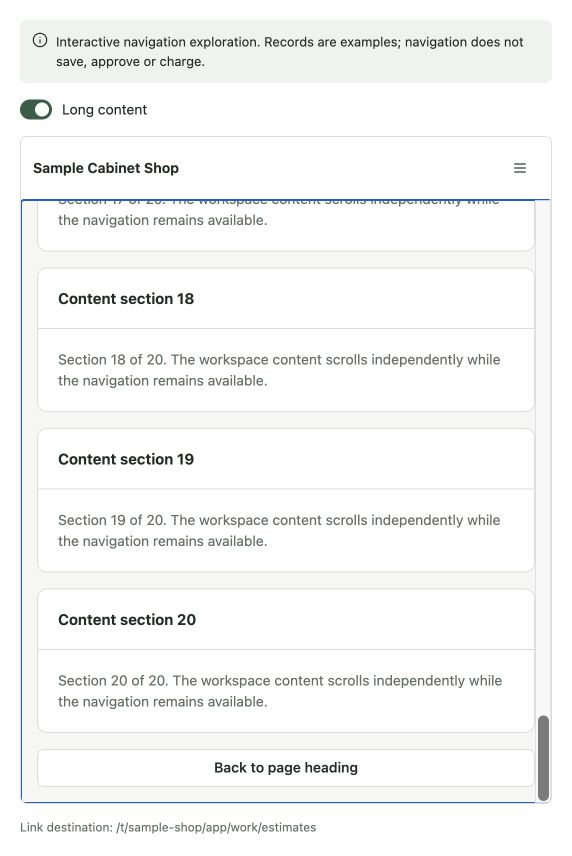

# Workspace scrolling repair

The page wrapper declared a flex-column layout but never applied it. Long content made the implicit grid row expand beyond the fixed workspace height. The surrounding `overflow: clip` then hid content that was not inside a usable scrollport.

Apply the existing `styles.page` to the wrapper so the existing content scrollport receives a bounded height. Give the scrollport an accessible region name and a keyboard focus target. Navigation retains its independent overflow behavior. Package version: 0.10.1.

The workspace catalog's **Long content** switch adds 20 sections and a final **Back to page heading** control. Use it in the embedded or full-screen example to verify the entire scroll range, nested table scrolling, narrow navigation header, and keyboard focus/scroll behavior.

## Browser verification

- Before: content height and scroll height were both 4,074 pixels; the enclosing workspace was only 666 pixels tall and clipped the remainder. No independent content scrolling was possible.
- After, narrow layout: content viewport height 603 pixels with scroll height 4,074; wheel scrolling reached scrollTop 3,471 with zero remaining distance. The final control was fully inside the visible viewport. Activating it focused the heading and returned content to scrollTop zero. PageDown advanced the focused scrollport by 583 pixels.
- After, 1,280 × 720 desktop: keyboard PageDown reached the bottom (rounding within one pixel). The navigation's top position stayed exactly unchanged. The end control remained reachable.
- Lint, build, typecheck, 132 tests and native package validation passed. Package validation used a writable temporary npm cache because the default cache is outside the environment's writable roots.

These images are from the actual local catalog using the shared component. No Cabinitron adoption or release is included; that remains a separate versioned app change after behavior confirmation.

## Before

## After: desktop end of content

## After: narrow end of content

