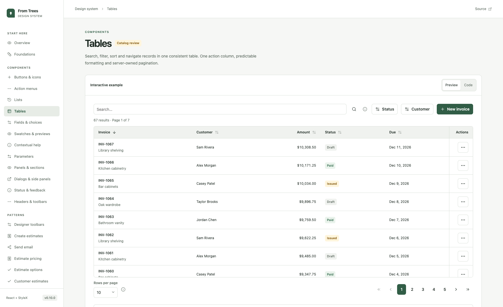
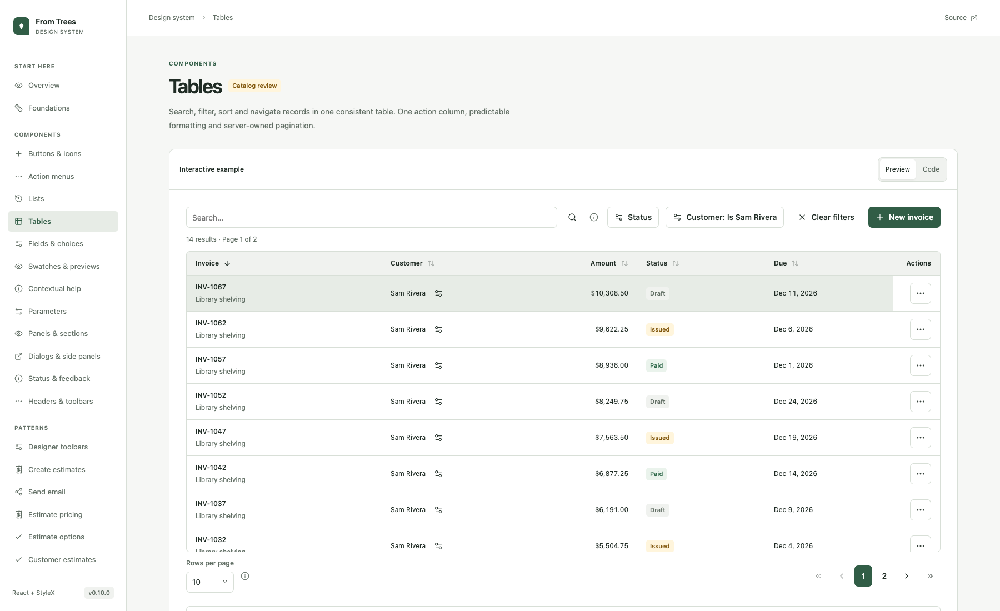

# Inline customer filter shortcut

Text DataTable columns can supply an optional `inlineAction(item)` with a specific
accessible label, icon, callback and disabled state. It renders a ghost icon
button beside the cell label and supports pointer, Enter and Space activation
without opening the row. Existing columns remain unchanged when no action is supplied.

The Tables catalog demonstrates the requested customer shortcut with synthetic
invoices: clicking the filter icon beside a customer applies that customer's exact
filter, replaces any previous customer filter and resets pagination to page 1.
Other filters, search, sort and page size remain intact. Filtering runs against the
complete demo dataset before paging. The existing Customer toolbar control shows
the selected filter, and Clear filters restores the list.

## Validation

- Lint, typecheck, full component/catalog tests, package/catalog build and package check.
- Browser verification: Sam Rivera narrows 67 total records to 14 matching records;
  the toolbar displays the active customer filter and Clear filters restores all 67.
- Component test verifies pointer, Enter and Space activation, disabled controls,
  and independence from row opening.
- Catalog test starts on page 2 with an Issued status filter, applies a customer,
  and verifies page 1, matching results and retained status filtering.

## Review evidence

Before:

After:

Filtered:

## Scope and limitations

This change is the shared-component/catalog prerequisite for Cabinitron Estimates.
It uses the existing filter icon and button components. The application continues
to own business scoping, server filtering and URL persistence. It does not modify
Cabinitron or publish a package. Catalog behavior needs user confirmation before a
separate versioned package adoption and native Cabinitron diff review.
